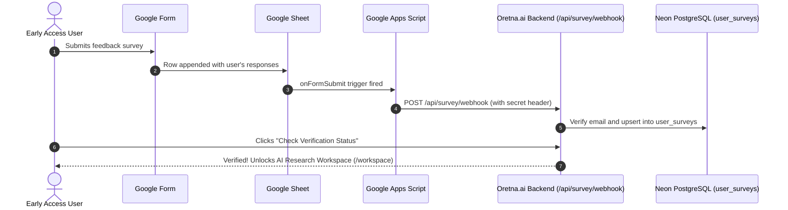

# Google Forms & Google Sheets Webhook Integration for Oretna.ai

This guide explains how to connect your live Google Form submissions directly to the Oretna.ai pre-launch survey verification webhook.

---

## Architecture Overview



---

## Step 1: Link Your Google Form to a Google Sheet

1. Open your Google Form: [Open Google Form](https://docs.google.com/forms/d/e/1FAIpQLSdQJHsNInFAbJkEI8EpuGMJtXOjgS1WGAJpINqlNQDY1O5pKw/edit).
2. Click on the **Responses** tab at the top.
3. Click **Link to Sheets** (the green spreadsheet icon) and select **Create a new spreadsheet** (e.g. `Oretna.ai Survey Responses`).
4. Click **Create**. The linked Google Sheet will open.

---

## Step 2: Open Apps Script in the Google Sheet

1. Inside your Google Sheet, click **Extensions** in the top menu bar.
2. Click **Apps Script**. A new tab will open with the script editor.

---

## Step 3: Paste the Webhook Integration Code

Replace all the code in the editor with the following script:

```javascript
/**
 * Oretna.ai Pre-Launch Google Form Submission Webhook
 * Automatically notifies Oretna backend when a user submits the survey.
 */

// Replace this with your live production backend URL once deployed (e.g. https://api.oretna.ai/api/survey/webhook)
// For local testing with ngrok or local tunnel: https://<your-subdomain>.ngrok-free.app/api/survey/webhook
const WEBHOOK_URL = 'https://api.oretna.ai/api/survey/webhook';

// Secret configured in backend/.env (SURVEY_WEBHOOK_SECRET)
const WEBHOOK_SECRET = 'oretna_survey_secret_2026_x7k9';

function onFormSubmit(e) {
  try {
    if (!e || !e.namedValues) {
      Logger.log('No event namedValues received.');
      return;
    }

    const namedValues = e.namedValues;
    Logger.log('Received submission named values: ' + JSON.stringify(namedValues));

    // Extract email from form response fields
    // Looks for common headers: "Email", "Email address", "Email Address", or the first column containing @
    let email = '';
    const emailKeys = ['Email address', 'Email Address', 'Email', 'Your email', 'Account email'];
    for (const key of emailKeys) {
      if (namedValues[key] && namedValues[key][0]) {
        email = namedValues[key][0].trim();
        break;
      }
    }

    // Fallback: search all values for an @ symbol if header varies
    if (!email) {
      for (const key in namedValues) {
        const val = namedValues[key][0];
        if (val && typeof val === 'string' && val.includes('@') && val.includes('.')) {
          email = val.trim();
          break;
        }
      }
    }

    if (!email) {
      Logger.log('Could not find an email address in the submission.');
      return;
    }

    // Extract optional metadata
    const fullName = namedValues['Full name']?.[0] || namedValues['Name']?.[0] || '';
    const category = namedValues['User category']?.[0] || '';
    const mostValuable = namedValues['The single most valuable feature']?.[0] || '';
    const responseId = 'gform_' + new Date().getTime();

    const payload = {
      email: email.toLowerCase(),
      fullName: fullName,
      category: category,
      mostValuableFeature: mostValuable,
      responseReference: responseId,
      timestamp: new Date().toISOString()
    };

    const options = {
      method: 'post',
      contentType: 'application/json',
      headers: {
        'x-survey-secret': WEBHOOK_SECRET
      },
      payload: JSON.stringify(payload),
      muteHttpExceptions: true
    };

    const response = UrlFetchApp.fetch(WEBHOOK_URL, options);
    Logger.log('Response code from Oretna backend: ' + response.getResponseCode());
    Logger.log('Response body: ' + response.getContentText());
  } catch (err) {
    Logger.log('Error sending survey webhook: ' + err.toString());
  }
}
```

3. Click the **Save** icon (diskette icon) or press `Ctrl + S`.

---

## Step 4: Configure the "On Form Submit" Trigger

1. In the Apps Script sidebar on the left, click **Triggers** (the clock icon ⏰).
2. Click **+ Add Trigger** (bottom right button).
3. Configure the trigger settings:
   - **Choose which function to run**: `onFormSubmit`
   - **Choose which deployment should run**: `Head`
   - **Select event source**: `From spreadsheet`
   - **Select event type**: `On form submit`
   - **Failure notification settings**: `Notify me immediately`
4. Click **Save**.
5. Google will ask for permissions. Click **Review Permissions**, select your Google account, click **Advanced** -> **Go to Untitled project (unsafe)**, and click **Allow**.

---

## Step 5: Verification & Testing

1. Fill out your Google Form in a new tab using the email of an account registered on Oretna.ai.
2. In Google Apps Script, click **Executions** in the left sidebar to see the log of `onFormSubmit`.
3. Go back to Oretna.ai's onboarding survey page (`/onboarding/survey`) and click **Check Verification Status**.
4. The page will immediately update to:
   > **"✓ Your survey response has been verified! You now have access."**
   and provide the button **"Continue to Application →"** to enter `/workspace`.
